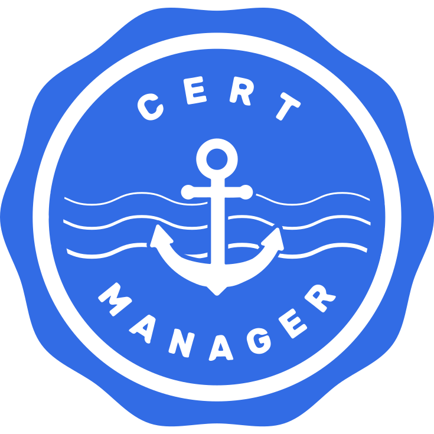
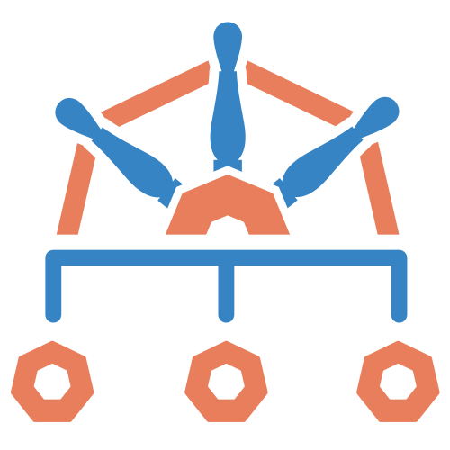

# Kubernetes Homelab

**A bare-metal Kubernetes homelab operating across dual-node Proxmox VE hardware.**

* [🏛️ Architecture & Overview](./docs/README.md)
* [📋 ADRs](./docs/adr/README.md)
* [🚀 Bootstrap](./bootstrap/README.md)
* [📝 Engineering Log](./docs/engineering-log.md)

---

An architectural evolution from the single-node [observability-hub](https://github.com/victoriacheng15/observability-hub), this bare-metal Kubernetes homelab expands across two physical Proxmox VE hosts and a Raspberry Pi quorum tiebreaker. Built to practice production cluster operations, zero-trust network policies, kernel runtime observability, and declarative GitOps pipelines across distributed physical hardware.

## Why This Exists

Built to expand beyond single-machine experiments and disposable cloud setups, evolving the foundations of [observability-hub](https://github.com/victoriacheng15/observability-hub) across distributed physical infrastructure:

* **From Single-Node to Distributed Topology:** Scales the single-machine GitOps and Cilium foundations into a multi-node bare-metal environment, confronting real node failure domains and quorum management.
* **Control Plane Isolation:** Centralized control plane with strict `NoSchedule` taints to preserve API stability.
* **Kernel Datapath & In-Cluster Routing:** Cilium eBPF in isolated VXLAN overlay mode, avoiding host routing table modifications or physical LAN disruption.
* **Zero-Drift GitOps:** ArgoCD as the authoritative reconciler for all cluster services, observability daemons, and security tools.
* **Resilience Under Constraints:** Asymmetric physical hardware (Mini PC + Laptop) with external Raspberry Pi Corosync quorum (`corosync-qnetd`) to prevent split-brain states.

## Architecture


* **Asymmetric Compute:** `pve-01` (Mini PC) runs the Control Plane (`k8s-cp-01`) and Telemetry Stack (`k8s-telemetry-01`). `pve-02` (Laptop) runs application and chaos testing workloads (`k8s-app-01`).
* **Quorum Stability:** `rpi-01` acts as a 3rd Corosync vote (`corosync-qnetd`), allowing the cluster to maintain quorum even when the laptop node is powered off.
* **Network Isolation:** Cilium enforces pod-to-pod networking and L3/L4/L7 policies via eBPF without attaching native bypasses to physical host network interfaces.

## Tech Stack

| | Name | Description |
| :---: | :--- | :--- |
|  | [Kubernetes (k3s)](https://k3s.io/) | Lightweight Kubernetes distribution with embedded etcd |
|  | [Cilium](https://cilium.io/) | eBPF-based CNI, isolated VXLAN overlay, kube-proxy replacement, Hubble |
|  | [Argo CD](https://argoproj.github.io/cd/) | GitOps continuous delivery engine syncing manifests directly from Git |
|  | [cert-manager](https://cert-manager.io/) | Automated TLS certificate management and local CA issuance |
|  | [Prometheus](https://prometheus.io/) | Time-series metrics collection and monitoring |
|  | [Grafana](https://grafana.com/) | Visualization dashboards for metrics, traces, and Hubble flows |
|  | [OpenTelemetry](https://opentelemetry.io/) | Distributed tracing and OTLP telemetry collection |
|  | [Podinfo](https://github.com/stefanprodan/podinfo) | Cloud-native microservice for GitOps validation, metrics, and traffic shifting |
|  | [Chaos Mesh](https://chaos-mesh.org/) | Chaos engineering platform for controlled fault injection |
|  | [Falco](https://falco.org/) | Kernel runtime security daemon detecting unauthorized syscalls |
|  | [Kyverno](https://kyverno.io/) | Kubernetes-native admission controller and policy enforcement |
|  | [OWASP Juice Shop](https://owasp.org/www-project-juice-shop/) | Vulnerable web application for runtime security drills and policy hardening |

## Hardware

| | Device | Node Name | Arch | RAM | Role |
| :---: | :--- | :--- | :--- | :--- | :--- |
|  | Mini PC | `pve-01` | x86_64 | 32 GB | Proxmox host (`k8s-cp-01`, `k8s-telemetry-01`) |
|  | Laptop | `pve-02` | x86_64 | 8 GB | Proxmox host (`k8s-app-01` worker) |
|  | Raspberry Pi 3B | `rpi-01` | ARM64 | 1 GB | Corosync QDevice quorum tiebreaker (`corosync-qnetd`) |

## Quick Verification

Validate the entire node discovery, kernel tuning, and cluster bootstrap suite in dry-run mode:

```bash
make bootstrap-dry-run
```
