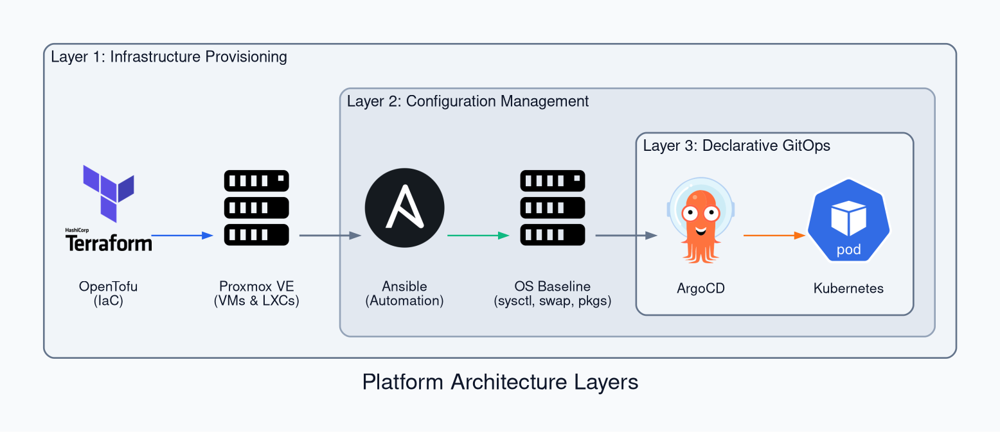
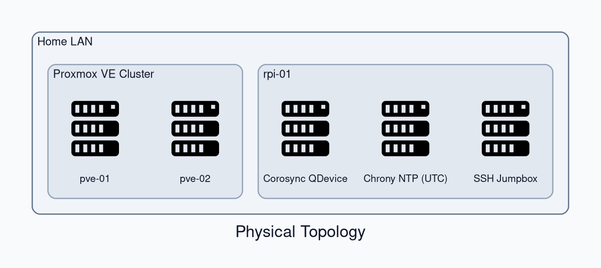
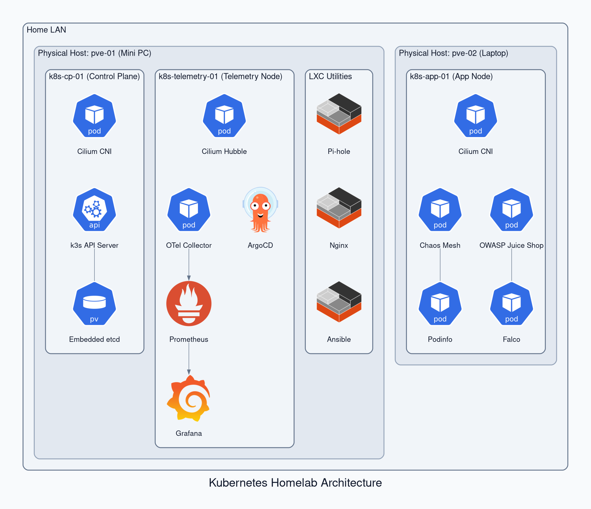
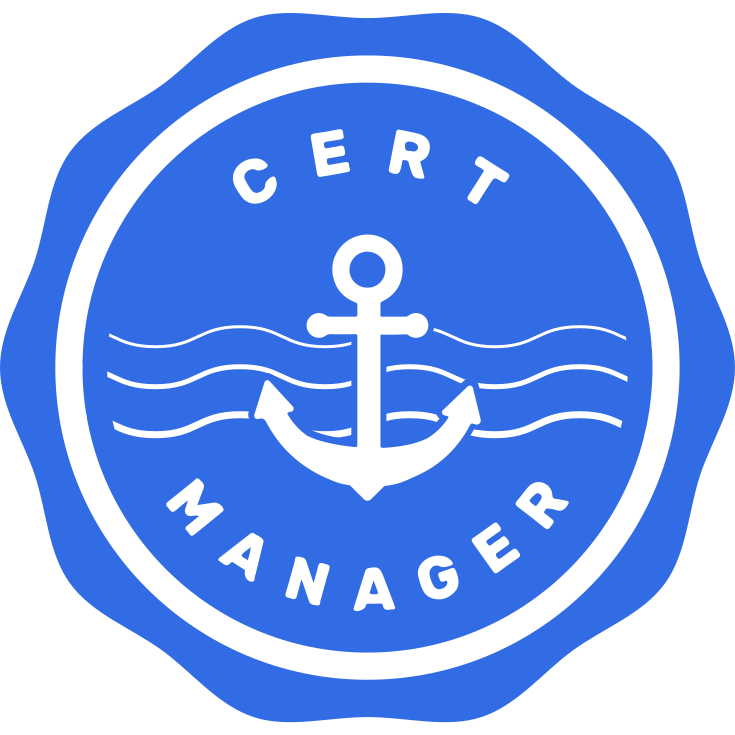
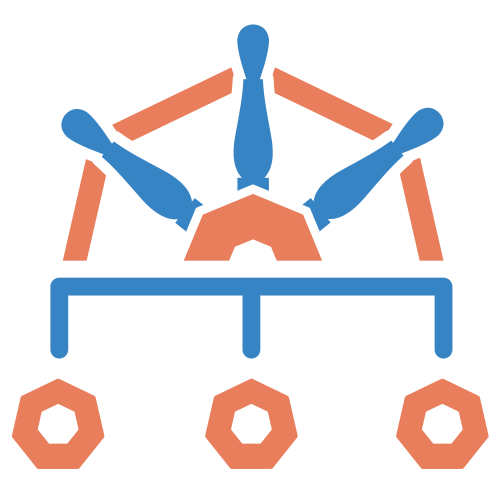

# Kubernetes Homelab Documentation

Technical specifications, design decisions, and operational runbooks for a bare-metal Kubernetes cluster operating across dual-node Proxmox VE hardware and an external Raspberry Pi quorum witness.

For the narrative story behind the architectural choices and operational lessons, read [The Platform Journey](./journey.md).

---

## Why This Exists

Built to expand beyond single-machine experiments and disposable cloud setups, evolving the foundations of [observability-hub](https://github.com/victoriacheng15/observability-hub) across distributed physical infrastructure:

* **Distributed Topology:** Scales across multi-node hardware using an external Raspberry Pi tiebreaker to manage quorum and node failure domains.
* **Three-Tier Platform Lifecycle:** Enforces strict boundaries across infrastructure (OpenTofu), host OS baselines (Ansible), and workloads (ArgoCD).
* **Control Plane Isolation:** Isolates the control plane with `NoSchedule` taints to protect API stability.
* **Host Network Management:** Manages machine IP addressing via DHCP and static reservations across physical hosts and VMs.
* **Kernel Datapath & Routing:** Routes pod traffic via Cilium eBPF and VXLAN overlay without disrupting the home LAN.
* **Zero-Drift GitOps:** Reconciles all cluster services and platform tools automatically using ArgoCD.

---

## Platform Architecture Layers

---

## Hardware

| | Device | Node Name | Arch | RAM | Role |
| :---: | :--- | :--- | :--- | :--- | :--- |
|  | Mini PC | `pve-01` | x86_64 | 32 GB | Proxmox host (`k8s-cp-01`, `k8s-telemetry-01`) |
|  | Laptop | `pve-02` | x86_64 | 8 GB | Proxmox host (`k8s-app-01` worker) |
|  | Raspberry Pi 3B | `rpi-01` | ARM64 | 1 GB | Corosync QDevice, Chrony NTP, and SSH Jumpbox |

---

## K8s Architecture Topology

---

## Tech Stack

### Infrastructure & Gateway

| | Name | Description |
| :---: | :--- | :--- |
|  | [OpenTofu](https://opentofu.org/) | Declarative virtual machine and LXC infrastructure provisioning via Proxmox API |
|  | [Ansible](https://www.ansible.com/) | Agentless OS baseline hardening, kernel tuning, and utility container automation |
|  | [Nginx](https://nginx.org/) | External reverse proxy gateway for unified internal DNS and NodePort routing |
|  | [Pi-hole](https://pi-hole.net/) | DNS sinkhole providing wildcard resolution (*.homelab.local) for LAN clients |

### Cluster Core & Networking

| | Name | Description |
| :---: | :--- | :--- |
|  | [Kubernetes (k3s)](https://k3s.io/) | Lightweight Kubernetes distribution with embedded etcd |
|  | [Cilium](https://cilium.io/) | eBPF-based CNI, isolated VXLAN overlay, kube-proxy replacement, Hubble |
|  | [Argo CD](https://argoproj.github.io/cd/) | GitOps continuous delivery engine syncing manifests directly from Git |
|  | [cert-manager](https://cert-manager.io/) | Automated TLS certificate management and local CA issuance |

### Observability & Telemetry

| | Name | Description |
| :---: | :--- | :--- |
|  | [Prometheus](https://prometheus.io/) | Time-series metrics collection and monitoring |
|  | [Grafana](https://grafana.com/) | Visualization dashboards for metrics, traces, and Hubble flows |
|  | [OpenTelemetry](https://opentelemetry.io/) | Distributed tracing and OTLP telemetry collection |
|  | [Podinfo](https://github.com/stefanprodan/podinfo) | Cloud-native microservice for GitOps validation, metrics, and traffic shifting |

### Security & Chaos Engineering

| | Name | Description |
| :---: | :--- | :--- |
|  | [Falco](https://falco.org/) | Kernel runtime security daemon detecting unauthorized syscalls |
|  | [Kyverno](https://kyverno.io/) | Kubernetes-native admission controller and policy enforcement |
|  | [Chaos Mesh](https://chaos-mesh.org/) | Chaos engineering platform for controlled fault injection |
|  | [OWASP Juice Shop](https://owasp.org/www-project-juice-shop/) | Vulnerable web application for runtime security drills and policy hardening |
