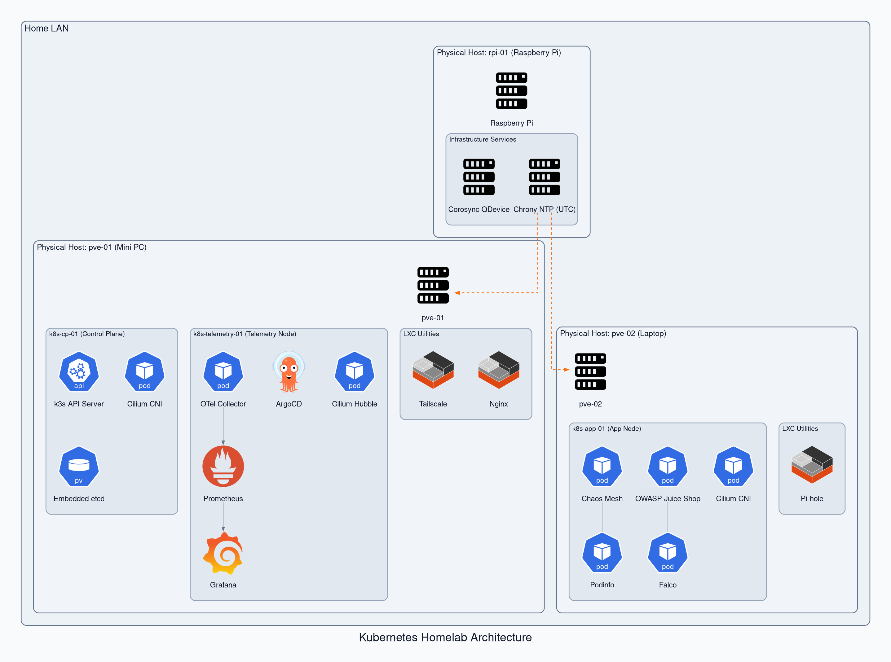

# Kubernetes Homelab Documentation

Technical specifications, design decisions, and operational runbooks for a bare-metal Kubernetes cluster operating across dual-node Proxmox VE hardware and an external Raspberry Pi quorum witness.

---

## Why This Exists

Built to expand beyond single-machine experiments and disposable cloud setups, evolving the foundations of [observability-hub](https://github.com/victoriacheng15/observability-hub) across distributed physical infrastructure:

* **From Single-Node to Distributed Topology:** Scales the single-machine GitOps and Cilium foundations into a multi-node bare-metal environment, confronting real node failure domains and quorum management.
* **Control Plane Isolation:** Centralized control plane with strict `NoSchedule` taints to preserve API stability.
* **Kernel Datapath & In-Cluster Routing:** Cilium eBPF in isolated VXLAN overlay mode, avoiding host routing table modifications or physical LAN disruption.
* **Zero-Drift GitOps:** ArgoCD as the authoritative reconciler for all cluster services, observability daemons, and security tools.
* **Resilience Under Constraints:** Asymmetric physical hardware (Mini PC + Laptop) with external Raspberry Pi Corosync quorum (`corosync-qnetd`) to prevent split-brain states.

---

## Physical Hardware Baseline

| Host | Hardware Type | CPU / Threads | Memory | Storage | Primary Cluster Roles |
| :--- | :--- | :--- | :--- | :--- | :--- |
| **`pve-01`** | Mini PC | 8C / 16T | 32 GB | 1 TB NVMe | `k8s-cp-01` (Control Plane), `k8s-telemetry-01`, LXC Utilities |
| **`pve-02`** | Laptop | 4C / 8T | 8 GB | 256 GB SSD | `k8s-app-01` (Worker), `pihole` (CT 300) |
| **`rpi-01`** | Raspberry Pi | 4C / 4T | 2 GB+ | MicroSD | Corosync QNet QDevice (Vote 3), Local Chrony NTP (UTC) |

---

## Architecture Topology

