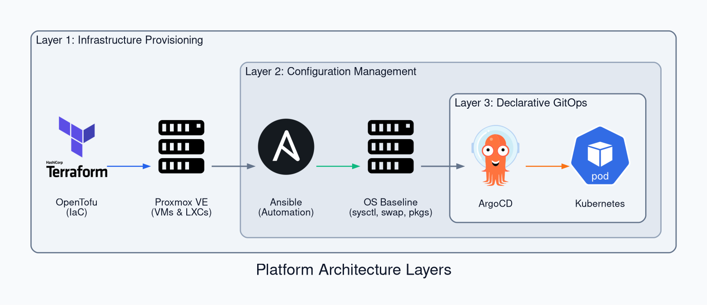
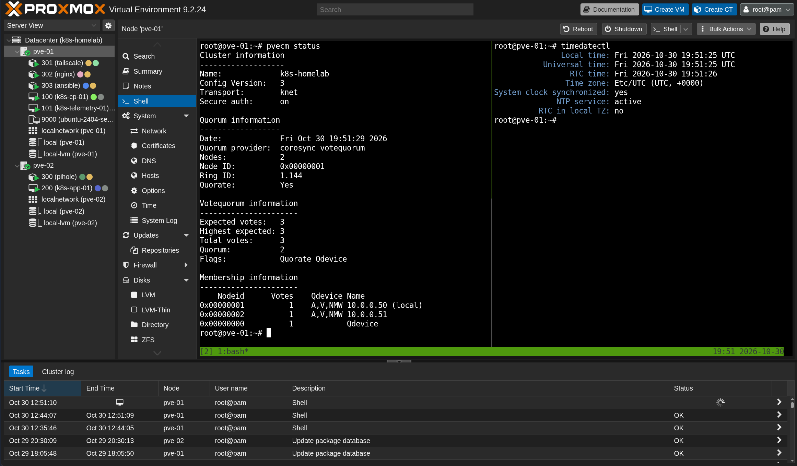
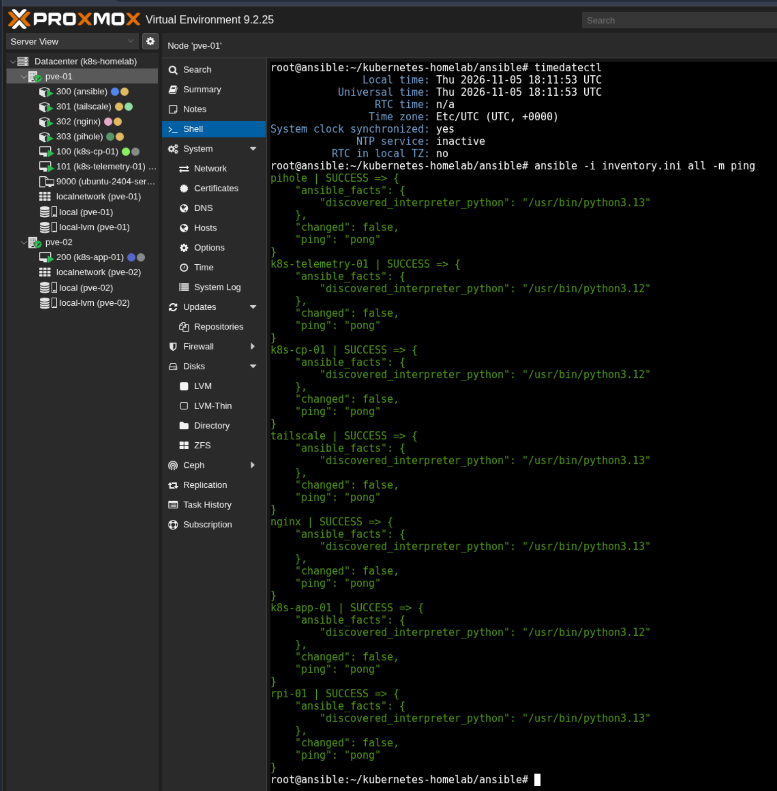
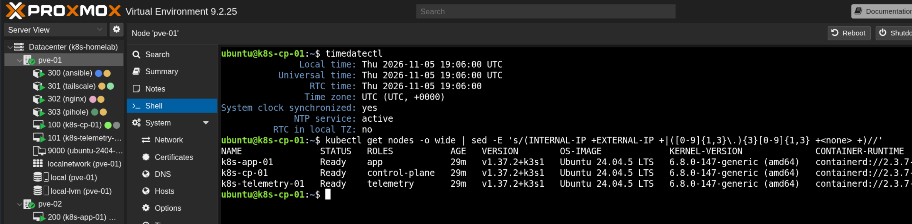
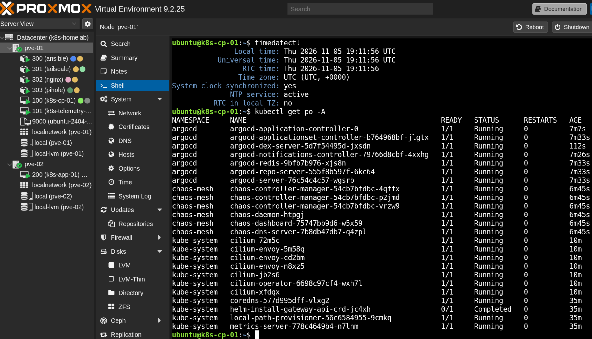
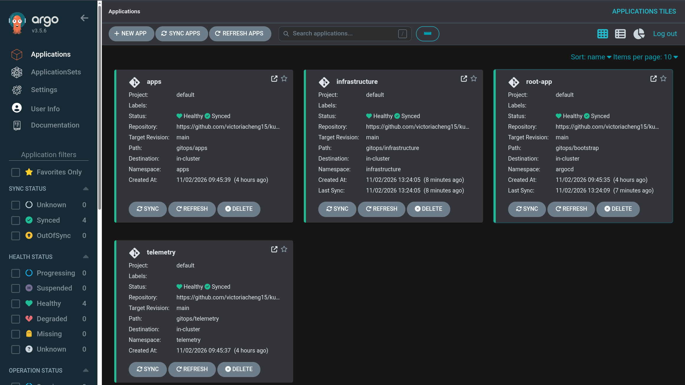

# Platform Provisioning

## Overview

This guide covers the three sequential provisioning layers that build the homelab platform from bare-metal hardware to declarative workload delivery:



| Layer | Primary Tooling | Responsibilities & Scope |
| :--- | :--- | :--- |
| **Layer 1: Infrastructure** | OpenTofu & Proxmox VE | Physical hypervisor clustering, Corosync QDevice quorum tiebreaker, Chrony NTP synchronization, Ubuntu cloud-init templates, and automated VM/LXC provisioning |
| **Layer 2: Node OS Baseline** | Ansible | Kernel modules (`overlay`, `br_netfilter`), swap deactivation, sysctl parameters, Pi-hole DNS sinkhole, and Tailscale VPN gateway |
| **Layer 3: Declarative GitOps** | k3s & ArgoCD | k3s control plane, Cilium eBPF network fabric, ArgoCD App-of-Apps sync waves, and Nginx reverse proxy dashboard routing |

---

## Layer 1: Infrastructure Provisioning

### Cluster & Quorum Setup

Physical hosts must be joined into a cluster with an external QDevice tiebreaker to maintain an odd 3-vote quorum:

- **Initialize Cluster on Primary Node (`pve-01`):**

  ```bash
  pvecm create k8s-homelab
  ```

- **Join Secondary Node (`pve-02`):**

  ```bash
  pvecm add <PRIMARY_NODE_IP>
  ```

- **Install QNetd on Raspberry Pi (`rpi-01`):**

  ```bash
  sudo apt update && sudo apt install -y corosync-qnetd
  ```

- **Install QDevice on Proxmox Hosts (`pve-01`, `pve-02`):**

  ```bash
  apt update && apt install -y corosync-qdevice
  ```

- **Attach QDevice & Verify Quorum from Primary Node (`pve-01`):**

  ```bash
  pvecm qdevice setup <QDEVICE_IP>
  pvecm status
  ```

??? note "Screenshot: Proxmox Cluster & QDevice Quorum"
    

### Time Synchronization

Distributed consensus engines (etcd in k3s and Corosync in Proxmox) require sub-second clock synchronization:

- **Configure Local Chrony NTP Server on Raspberry Pi (`rpi-01`):**

  ```bash
  sudo timedatectl set-timezone UTC
  sudo apt update && sudo apt install -y chrony
  echo -e "server time.cloudflare.com iburst\nallow 192.168.0.0/16\nallow 10.0.0.0/8" | sudo tee -a /etc/chrony/chrony.conf
  sudo systemctl restart chrony
  ```

- **Synchronize Proxmox Hosts (`pve-01`, `pve-02`) Against `rpi-01`:**

  ```bash
  echo "server <RPI_IP> iburst prefer" | sudo tee -a /etc/chrony/chrony.conf
  sudo systemctl restart chrony && chronyc sources -v
  ```

### Cloud-Init Template

Create the Ubuntu 24.04 Server template (VM 9000) on local hypervisor storage:

- **Download and Customize Ubuntu 24.04 Cloud Image:**

  Install `libguestfs-tools` to inject `qemu-guest-agent` and truncate `/etc/machine-id` (preventing cloned DHCP lease collisions) directly on the disk image before importing:

  ```bash
  apt update && apt install -y libguestfs-tools
  wget https://cloud-images.ubuntu.com/noble/current/noble-server-cloudimg-amd64.img
  virt-customize -a noble-server-cloudimg-amd64.img --install qemu-guest-agent --truncate /etc/machine-id
  ```

- **Create Template VM and Import Virtual Disk:**

  ```bash
  qm create 9000 --name "ubuntu-2404-server-template" --memory 2048 --cores 2 --cpu host --net0 virtio,bridge=vmbr0
  qm disk import 9000 noble-server-cloudimg-amd64.img local-lvm
  ```

- **Configure Cloud-Init Hardware & Convert to Template:**

  ```bash
  qm set 9000 --scsihw virtio-scsi-single --scsi0 local-lvm:vm-9000-disk-0,discard=on,ssd=1
  qm set 9000 --ide2 local-lvm:cloudinit --boot order=scsi0 --serial0 socket --vga serial0
  qm set 9000 --agent enabled=1
  qm template 9000
  rm noble-server-cloudimg-amd64.img
  ```

### OpenTofu Deployment

Deploy virtual machines and utility containers:

- **Generate SSH Key Pairs for Fleet Access:**

  Both the administrator key and the Ansible automation key are created directly on the **Proxmox host (`pve-01`)**:

  Create the administrator key for interactive operator access:

  ```bash
  ssh-keygen -t ed25519 -C "k8s-homelab-admin"
  cat ~/.ssh/id_ed25519.pub
  ```

  Create the dedicated automation key pair for the Ansible controller:

  ```bash
  ssh-keygen -t ed25519 -f ~/.ssh/ansible -C "ansible"
  cat ~/.ssh/ansible.pub
  ```

- **Configure Environment Variables (Local Workstation):**

  Generate a Proxmox API token (`root@pam!tofu`) with Privilege Separation unchecked under `Datacenter -> Permissions -> API Tokens`.
  Populate `infra/terraform.tfvars` from `infra/terraform.tfvars.example`, supplying the `admin_ssh_public_key` and `ansible_ssh_public_key` public keys generated on `pve-01` alongside your host endpoints, credentials, and static network leases.

- **Provision Infrastructure Resources (Local Workstation):**

  ```bash
  tofu -chdir=infra init
  tofu -chdir=infra plan
  tofu -chdir=infra apply
  ```

- **Inject Automation Key into Controller Container (`pve-01`):**

  On **`pve-01`**, transfer the automation key pair directly into the newly created Ansible container:

  ```bash
  pct exec 300 -- mkdir -p /root/.ssh
  pct push 300 ~/.ssh/ansible /root/.ssh/ansible -perms 0600
  pct push 300 ~/.ssh/ansible.pub /root/.ssh/ansible.pub -perms 0644
  ```

### Standalone Utility Containers

Alongside the Kubernetes virtual machines, OpenTofu provisions unprivileged Debian LXC utility containers:

| Container | ID | Host | IP Mode | Operational Purpose |
| :--- | :--- | :--- | :--- | :--- |
| **`ansible`** | `CT 300` | `pve-01` | DHCP | Dedicated automation controller node running playbooks across the fleet |
| **`tailscale`** | `CT 301` | `pve-01` | DHCP | Encrypted mesh VPN subnet router gateway (`homelab_subnet`) |
| **`nginx`** | `CT 302` | `pve-01` | DHCP | Local reverse proxy and SSL gateway for cluster dashboards |
| **`pihole`** | `CT 303` | `pve-01` | Static / DHCP | Local DNS sinkhole and wildcard domain resolver (`*.homelab.local`) |

---

## Layer 2: Node OS Baseline & Utility Services Provisioning

Before bootstrapping Kubernetes, all VM nodes must have active swap disabled, kernel networking modules loaded, and sysctl packet forwarding rules applied. Additionally, foundational utility containers (Pi-hole DNS and Tailscale VPN) are provisioned.

This baseline tuning and utility automation is orchestrated using Ansible from the dedicated controller container on `pve-01`:

- **Access the Controller Container (`pve-01`):**

  ```bash
  pct enter 300
  ```

- **Bootstrap Ansible Tooling:**

  ```bash
  apt update && apt install -y curl git locales
  sed -i 's/^# *en_US.UTF-8/en_US.UTF-8/' /etc/locale.gen
  locale-gen en_US.UTF-8
  update-locale LANG=en_US.UTF-8

  curl -LsSf https://astral.sh/uv/install.sh | sh
  source $HOME/.local/bin/env
  uv tool install ansible-core
  ```

- **Clone Repository & Install Collection Dependencies:**

  ```bash
  git clone https://github.com/victoriacheng15/kubernetes-homelab.git
  cd kubernetes-homelab/ansible
  ansible-galaxy collection install -r requirements.yml
  ```

- **Configure Inventory & Test Fleet Reachability:**

  ```bash
  cp inventory.example.ini inventory.ini
  ansible -i inventory.ini all -m ping
  ```

??? note "Screenshot: Fleet Reachability Verification (`all -m ping`)"
    

### VM Node Baseline Hardening (`01-setup-vms.yml`)

Execute the baseline playbook across all virtual machine nodes (`k8s-cp-01`, `k8s-telemetry-01`, `k8s-app-01`):

```bash
ansible-playbook -i inventory.ini playbooks/01-setup-vms.yml
```

The baseline playbook enforces the following system configurations across all nodes:

- **Timezone:** Locks system clock to UTC.
- **Swap:** Disables active swap (`swapoff -a`) and permanently comments out swap mounts in `/etc/fstab`.
- **Kernel Modules:** Loads `overlay` and `br_netfilter`, persisting them in `/etc/modules-load.d/k8s.conf`.
- **Sysctl Parameters:** Enables IP packet forwarding (`net.ipv4.ip_forward = 1`) and bridge netfilter calls.
- **Core Packages:** Installs essential troubleshooting utilities (`curl`, `git`, `jq`, `tcpdump`, `socat`, `htop`, `tar`).

### Utility Containers Provisioning

Standalone Debian LXC utility containers are configured with auxiliary services:

- **Local Wildcard DNS Sinkhole (`02-setup-pihole.yml`):**

  ```bash
  ansible-playbook -i inventory.ini playbooks/02-setup-pihole.yml
  ```

  Verify Pi-hole status (via Ansible controller or directly on the `pihole` container):

  ```bash
  ansible -i inventory.ini dns -m command -a "pihole status"
  ```

- **Encrypted Mesh Subnet Router (`03-setup-tailscale.yml`):**

  Because Tailscale operates inside an unprivileged LXC container, `/dev/net/tun` device passthrough must be enabled on the Proxmox host (`pve-01`) before starting the service:

  ```bash
  cat << 'EOF' >> /etc/pve/lxc/301.conf
  lxc.cgroup2.devices.allow: c 10:200 rwm
  lxc.mount.entry: /dev/net/tun dev/net/tun none bind,create=file
  EOF
  pct reboot 301
  ```

  Deploy the Tailscale configuration from the Ansible controller:

  ```bash
  ansible-playbook -i inventory.ini playbooks/03-setup-tailscale.yml
  ```

  Verify Tailscale status (via Ansible controller or directly on the `tailscale` container):

  ```bash
  ansible -i inventory.ini vpn -m command -a "tailscale status"
  ```

---

## Layer 3: Declarative GitOps & Cluster Provisioning

Once the physical hypervisors are clustered (Layer 1) and all virtual machine OS baselines and utility services are hardened (Layer 2), the final tier provisions the Kubernetes platform and declarative GitOps delivery engine.

By orchestrating the underlying bootstrap scripts inside numbered Ansible playbooks, cluster provisioning is repeatable, automated, and decoupled from manual execution on individual nodes.

### Preflight Hardware & Network Audit

Before initializing the cluster, execute `bootstrap/00-preflight.sh` as an optional read-only sanity check. This audits target node IPs, CPU virtualization flags, kernel eBPF support, memory allocations, and open ports on target Kubernetes VMs (`k8s-cp-01`, `k8s-telemetry-01`, `k8s-app-01`).

Execute an on-demand audit across all virtual machines simultaneously using the Ansible ad-hoc CLI:

```bash
ansible -i inventory.ini nodes -m ansible.builtin.script -a "../bootstrap/00-preflight.sh"
```

To run against a single specific node (for example, `k8s-cp-01`):

```bash
ansible -i inventory.ini k8s-cp-01 -m ansible.builtin.script -a "../bootstrap/00-preflight.sh"
```

### Cluster Nodes Bootstrap (`04-bootstrap-cluster.yml`)

The cluster nodes playbook orchestrates the initialization of the control plane and automated joining of worker nodes without manual token copying:

```bash
ansible-playbook -i inventory.ini playbooks/04-bootstrap-cluster.yml
```

This playbook runs across three sequential plays:

- **Control Plane Initialization (`k8s-cp-01`):**
    - Executes `bootstrap/01-k3s-server.sh` via `ansible.builtin.script` with Flannel and Traefik disabled.
    - Captures the cluster join token from `/var/lib/rancher/k3s/server/node-token` and registers it in memory.

- **Worker Node Joining (`k8s-telemetry-01`, `k8s-app-01`):**
    - Executes `bootstrap/02-k3s-agent.sh` on worker targets, automatically injecting the join endpoint and cluster token.

- **Role & Workload Classification (`k8s-cp-01`):**
    - Labels dedicated node roles (`telemetry`, `app`) and workload profiles directly from the control plane in compliance with the Kubernetes NodeRestriction admission controller.

Verify node status from the control plane:

```bash
kubectl get nodes -o wide
```

??? note "Screenshot: Cluster Nodes & Role Classification Status"
    

### In-Cluster Platform & Network Services (`05-setup-cluster-services.yml`)

With nodes joined, deploy core networking, GitOps, and platform resilience tools to `k8s-cp-01`:

```bash
ansible-playbook -i inventory.ini playbooks/05-setup-cluster-services.yml
```

This playbook injects `KUBECONFIG: /etc/rancher/k3s/k3s.yaml` and deploys three platform tiers:

- **Cilium eBPF CNI & Hubble Observability (`bootstrap/03-cni-cilium.sh`):**
    - Deploys Cilium in VXLAN overlay mode (`10.244.0.0/16` Pod CIDR).
    - Replaces `kube-proxy` with socket-based in-kernel load balancing.
    - Enables Hubble relay and Hubble UI (NodePort `31235`).
    - Includes status verification checks to skip installation safely if already operational.

- **ArgoCD GitOps Continuous Delivery Engine (`bootstrap/04-gitops-argocd.sh`):**
    - Installs upstream ArgoCD manifests into the `argocd` namespace.
    - Exposes `argocd-server` via NodePort (`HTTP 30080`, `HTTPS 30443`).
    - Waits for controller readiness rollouts.

- **Chaos Mesh Resilience Platform (`bootstrap/05-chaos-mesh.sh`):**
    - Configures the Chaos Mesh Helm repository.
    - Deploys Chaos Mesh pinned to `k8s-app-01` (`workload=app`) using the k3s containerd socket (`/run/k3s/containerd/containerd.sock`).
    - Exposes the Chaos Mesh dashboard via NodePort (`31333`).

Key parameters configured across cluster services:

| Parameter | Value | Purpose |
| :--- | :--- | :--- |
| **Pod CIDR** | `10.244.0.0/16` | Eliminates subnet collisions with the physical LAN |
| **Host Routing** | `bpf.hostLegacyRouting=true` | Protects host-level SSH and management traffic |
| **Kube-Proxy** | In-kernel eBPF | High-performance socket-based load balancing |
| **Hubble** | Relay & UI enabled | Real-time L3/L4/L7 flow observability |
| **ArgoCD Ingress** | NodePort `30080` / `30443` | Reverse proxy entrypoint for GitOps UI and API |
| **Chaos Mesh Ingress** | NodePort `31333` | Reverse proxy entrypoint for Chaos Dashboard |

Verify platform service rollout across all namespaces:

```bash
kubectl get pods -A
```

??? note "Screenshot: Core Platform Pod Status (Cilium, ArgoCD, Chaos Mesh)"
    

### ArgoCD App-of-Apps Declarative Workload Reconciliation

Once ArgoCD is running, initialize declarative GitOps workload delivery:

- **Configure Workstation Cluster Access (`kubeconfig`):**

  To manage the cluster directly from your workstation without overwriting an existing `~/.kube/config`, save the configuration to a dedicated file:

  ```bash
  mkdir -p ~/.kube
  ssh ubuntu@<k8s-cp-01-ip> "sudo cat /etc/rancher/k3s/k3s.yaml" > ~/.kube/k8s
  chmod 600 ~/.kube/k8s
  sed -i "s/127.0.0.1/<k8s-cp-01-ip>/g" ~/.kube/k8s
  ```

- **Retrieve Initial ArgoCD Administrator Password:**

  ```bash
  kubectl --kubeconfig=$HOME/.kube/k8s -n argocd get secret argocd-initial-admin-secret -o jsonpath="{.data.password}" | base64 -d; echo
  ```

- **Apply Root Orchestrator Manifest:**

  ```bash
  kubectl --kubeconfig=$HOME/.kube/k8s apply -f gitops/root-application.yaml
  ```

The root application automatically watches `gitops/bootstrap/` and reconciles workloads across dedicated node roles and phases:

| Application | Target Path | Target Node / Namespace | Operational Role |
| :--- | :--- | :--- | :--- |
| **`root-app`** | `gitops/bootstrap` | `argocd` | Watches Git for child application manifests |
| **`infrastructure`** | `gitops/infrastructure` | `local-path-storage` / `infrastructure` | Wave 0 foundational platform tier (StorageClass, Cert-Manager, Kyverno, Falco) |
| **`telemetry`** | `gitops/telemetry` | `k8s-telemetry-01` / `telemetry` | Wave 1 observability stack (Hubble, Prometheus, Grafana, OpenTelemetry) |
| **`apps`** | `gitops/apps` | `k8s-app-01` / `apps` | Wave 2 tenant applications (Podinfo, Juice Shop) |

Verify application reconciliation status using CLI:

```bash
kubectl --kubeconfig=$HOME/.kube/k8s get applications -n argocd
kubectl --kubeconfig=$HOME/.kube/k8s get pods -A
```

??? note "Screenshot: ArgoCD Dashboard & Application Tree"
      

### Ingress Gateway & Reverse Proxy Setup (`06-setup-nginx.yml`)

Deploy the Nginx gateway configuration to the `nginx` container to establish reverse proxy routes for all platform dashboards:

```bash
ansible-playbook -i inventory.ini playbooks/06-setup-nginx.yml
```

Verify Nginx status and virtual host routes (via Ansible controller or directly on the `nginx` container):

```bash
ansible -i inventory.ini gateway -m command -a "nginx -t"
```

Access all homelab dashboards in your browser via the managed reverse proxy routes:

| Subdomain | Target Service | Operational Purpose |
| :--- | :--- | :--- |
| `argocd.homelab.local` | `argocd-server:30443` | GitOps continuous delivery management dashboard |
| `hubble.homelab.local` | `hubble-ui:31235` | Real-time eBPF network flow map and traffic inspection |
| `pihole.homelab.local` | `pihole-FTL:80` | Network-wide DNS sinkhole and ad-blocking administration |
| `grafana.homelab.local` | `grafana:30300` | Cluster resource metrics and telemetry visualization |
| `podinfo.homelab.local` | `podinfo:30098` | Reference microservice interface and canary routing testbed |
| `juiceshop.homelab.local` | `juice-shop:30081` | Vulnerable web application generating attack traffic for Falco |
| `chaos.homelab.local` | `chaos-dashboard:31333` | Visual experiment designer for fault injection and stress tests |

- **Configure Workstation Wildcard DNS Resolution (`systemd-resolved`):**

  To resolve `*.homelab.local` subdomains from your local workstation without editing `/etc/hosts` for every service, configure a persistent routing domain in `systemd-resolved` pointing to the Pi-hole DNS server:

  ```bash
  sudo mkdir -p /etc/systemd/resolved.conf.d

  sudo tee /etc/systemd/resolved.conf.d/homelab.conf << 'EOF'
  [Resolve]
  DNS=<pihole-ip>
  Domains=~homelab.local
  EOF

  sudo systemctl restart systemd-resolved
  ```

  Verify wildcard resolution from your workstation:

  ```bash
  dig pihole.homelab.local +short
  ```

---

## Master Pipeline Orchestration (`site.yml`)

For zero-touch full-fleet provisioning and disaster recovery drills ("The Phoenix Rebuild"), the entire platform from bare virtual machines to reverse proxy ingress can be executed sequentially using the master orchestrator playbook:

```bash
ansible-playbook -i inventory.ini site.yml
```

This master orchestrator runs all six numbered playbooks in strict dependency order:

- `playbooks/01-setup-vms.yml`: Base OS hardening, swap disabling, kernel networking modules, and sysctl rules.
- `playbooks/02-setup-pihole.yml`: Local DNS sinkhole and wildcard domain routing (`*.homelab.local`).
- `playbooks/03-setup-tailscale.yml`: Encrypted mesh VPN subnet router gateway.
- `playbooks/04-bootstrap-cluster.yml`: k3s control plane initialization, token capture, and worker node joining.
- `playbooks/05-setup-cluster-services.yml`: In-cluster Cilium eBPF CNI, ArgoCD GitOps engine, and Chaos Mesh platform.
- `playbooks/06-setup-nginx.yml`: Ingress gateway virtual host routing for all 7 platform dashboards.
