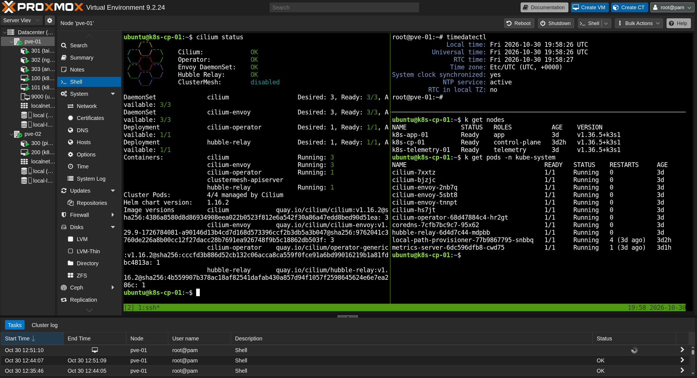

# Platform Provisioning

## Overview

This guide covers the three sequential provisioning layers that build the homelab platform from bare-metal hardware to declarative workload delivery:


- **Layer 1: Infrastructure Provisioning:** Uses OpenTofu and Proxmox VE to configure physical hypervisor clustering, odd 3-vote quorum tiebreaking, authoritative local time synchronization via Chrony, base OS templates, and automated VM and LXC creation.
- **Layer 2: Node OS Baseline Provisioning:** Uses Ansible from the dedicated controller container (`CT 303`) to tune kernel modules, swap, sysctl networking parameters, and core utilities across all virtual machines.
- **Layer 3: Declarative GitOps & Cluster Provisioning:** Uses k3s and ArgoCD to bootstrap the lightweight Kubernetes control plane, deploy the Cilium eBPF network fabric, and initialize the App-of-Apps continuous delivery engine.

---

## Layer 1: Infrastructure Provisioning

### Cluster & Quorum Setup

Physical hosts must be joined into a cluster with an external QDevice tiebreaker to maintain an odd 3-vote quorum:

- Initialize cluster on the primary node (`pve-01`).
- Join the secondary node (`pve-02`).
- Configure the external Raspberry Pi (`rpi-01`) quorum tiebreaker and verify status:

  ```bash
  # On primary node (pve-01):
  pvecm create k8s-homelab

  # On secondary node (pve-02):
  pvecm add <PRIMARY_NODE_IP>

  # On Raspberry Pi (rpi-01):
  sudo apt update && sudo apt install -y corosync-qnetd

  # On Proxmox hosts (pve-01 and pve-02):
  apt update && apt install -y corosync-qdevice

  # On primary node (pve-01), attach the QDevice:
  pvecm qdevice setup <QDEVICE_IP>
  pvecm status
  ```

??? note "Screenshot: Proxmox Cluster & QDevice Quorum"
    

### Time Synchronization

Distributed consensus engines (etcd in k3s and Corosync in Proxmox) require sub-second clock synchronization:

- Configure the Raspberry Pi (`rpi-01`) as the authoritative local Stratum 2 Chrony NTP server.
- Configure Proxmox hosts (`pve-01`, `pve-02`) to synchronize against `rpi-01`:

  ```bash
  # On Raspberry Pi (rpi-01): install Chrony and allow local homelab subnets
  sudo timedatectl set-timezone UTC
  sudo apt update && sudo apt install -y chrony
  echo -e "server time.cloudflare.com iburst\nallow 192.168.0.0/16\nallow 10.0.0.0/8" | sudo tee -a /etc/chrony/chrony.conf
  sudo systemctl restart chrony

  # On Proxmox hosts (pve-01 and pve-02): sync against rpi-01
  echo "server <RPI_IP> iburst prefer" | sudo tee -a /etc/chrony/chrony.conf
  sudo systemctl restart chrony && chronyc sources -v
  ```

### Cloud-Init Template

Create the Ubuntu 24.04 Server template (VM 9000) on local hypervisor storage:

- Download the official Ubuntu 24.04 cloud image.
- Initialize VM 9000, import the virtual disk to `local-lvm`, and attach the Cloud-Init drive.
- Convert the virtual machine to a permanent template:

  ```bash
  wget https://cloud-images.ubuntu.com/noble/current/noble-server-cloudimg-amd64.img
  qm create 9000 --name "ubuntu-2404-server-template" --memory 2048 --cores 2 --cpu host --net0 virtio,bridge=vmbr0
  qm disk import 9000 noble-server-cloudimg-amd64.img local-lvm
  qm set 9000 --scsihw virtio-scsi-single --scsi0 local-lvm:vm-9000-disk-0,discard=on,ssd=1
  qm set 9000 --ide2 local-lvm:cloudinit --boot order=scsi0 --serial0 socket --vga serial0
  qm template 9000
  rm -f noble-server-cloudimg-amd64.img
  ```

### OpenTofu Deployment

Deploy virtual machines and utility containers:

- Generate a Proxmox API token (`root@pam!tofu`) with Privilege Separation unchecked under `Datacenter -> Permissions -> API Tokens`.
- Populate `infra/terraform.tfvars` from `infra/terraform.tfvars.example` with host endpoints, credentials, and static network leases.
- Provision the infrastructure resources:

  ```bash
  cd infra && tofu init
  tofu plan
  tofu apply
  ```

### Standalone Utility Containers

Alongside the Kubernetes virtual machines, OpenTofu provisions unprivileged Debian LXC utility containers:

| Container | ID | Host | IP Mode | Operational Purpose |
| :--- | :--- | :--- | :--- | :--- |
| **`pihole`** | `CT 300` | `pve-02` | Static / DHCP | Local DNS sinkhole and wildcard domain resolver (`*.homelab.local`) |
| **`nginx`** | `CT 302` | `pve-01` | DHCP | Local reverse proxy and SSL gateway for ArgoCD, Hubble, and Grafana |
| **`ansible`** | `CT 303` | `pve-01` | DHCP | Dedicated automation controller node running playbooks across the fleet |

---

## Layer 2: Node OS Baseline Provisioning

Before bootstrapping Kubernetes, all VM nodes must have active swap disabled, kernel networking modules loaded, and sysctl packet forwarding rules applied. This baseline tuning is automated using Ansible from the dedicated controller container (`CT 303` on `pve-01`):

- Enter the controller container (`CT 303`) and bootstrap `ansible-core` using `uv`.
- Clone the repository and install collection dependencies.
- Verify fleet SSH ping connectivity and execute the baseline hardening playbook across all target virtual machines:

  ```bash
  # On pve-01: enter controller container
  pct enter 303

  # Install uv and ansible-core inside CT 303:
  curl -LsSf https://astral.sh/uv/install.sh | sh
  source $HOME/.local/bin/env
  uv tool install ansible-core

  # Clone repository and verify fleet connectivity:
  git clone https://github.com/victoriacheng15/kubernetes-homelab.git
  cd kubernetes-homelab/ansible
  ansible-galaxy collection install -r requirements.yml
  ansible nodes -m ping

  # Execute baseline playbook across k8s-cp-01, k8s-telemetry-01, and k8s-app-01:
  ansible-playbook playbooks/setup-vms.yml
  ```

The playbook enforces the following system baselines across all nodes (`k8s-cp-01`, `k8s-telemetry-01`, `k8s-app-01`):

- **Timezone:** Locks system clock to UTC.
- **Swap:** Disables active swap (`swapoff -a`) and permanently comments out swap mounts in `/etc/fstab`.
- **Kernel Modules:** Loads `overlay` and `br_netfilter`, persisting them in `/etc/modules-load.d/k8s.conf`.
- **Sysctl Parameters:** Enables IP packet forwarding (`net.ipv4.ip_forward = 1`) and bridge netfilter calls.
- **Core Packages:** Installs essential troubleshooting utilities (`curl`, `git`, `jq`, `tcpdump`, `socat`, `htop`, `tar`).

---

## Layer 3: Declarative GitOps & Cluster Provisioning

Once the physical hypervisors are clustered (Layer 1) and all virtual machine OS baselines are hardened (Layer 2), the final tier provisions the Kubernetes platform using k3s and ArgoCD as its declarative GitOps delivery engine.

### Preflight Environment Verification

Before running installation scripts, execute `bootstrap/00-preflight.sh` to audit system resources, kernel version, network ports, and verify that the Ansible OS baseline (timezone, swap, kernel modules, sysctl) is active across target nodes:

```bash
./bootstrap/00-preflight.sh
```

### Control Plane Initialization

Bootstrap the isolated control plane on `k8s-cp-01`:

- Execute the server bootstrap script to write declarative k3s settings with Traefik and Flannel disabled.
- Verify local control plane readiness:

  ```bash
  ./bootstrap/01-k3s-server.sh
  kubectl get nodes
  ```

Upon completion, the script outputs the cluster join endpoint and node token directly to the terminal for worker onboarding.

### Worker Node Onboarding

Join worker nodes into the cluster:

- Execute the agent bootstrap script on `k8s-telemetry-01` and `k8s-app-01`.
- Apply formal role labels from the control plane (`k8s-cp-01`):

  ```bash
  # On k8s-telemetry-01:
  sudo ./bootstrap/02-k3s-agent.sh \
    --server-url "https://<CONTROL_PLANE_IP>:6443" \
    --token "<JOIN_TOKEN>" \
    --node-role telemetry

  # On k8s-app-01:
  sudo ./bootstrap/02-k3s-agent.sh \
    --server-url "https://<CONTROL_PLANE_IP>:6443" \
    --token "<JOIN_TOKEN>" \
    --node-role app

  # From control plane (k8s-cp-01), apply formal role labels:
  kubectl label node k8s-telemetry-01 node-role.kubernetes.io/telemetry=true
  kubectl label node k8s-app-01 node-role.kubernetes.io/app=true
  ```

!!! note
    In accordance with the Kubernetes NodeRestriction admission plugin, worker nodes self-assign the `workload=<role>` label. Formal role labels are assigned from the control plane.

### CNI & Network Fabric Deployment

Deploy Cilium eBPF in VXLAN overlay mode from `k8s-cp-01`:

- Deploy Cilium CNI with kube-proxy replacement and Hubble telemetry enabled.
- Verify cluster health and eBPF datapath status:

  ```bash
  ./bootstrap/03-cni-cilium.sh
  cilium status --wait
  kubectl get nodes -o wide
  kubectl get pods -A
  ```

Key parameters configured by the script:

| Parameter | Value | Purpose |
| :--- | :--- | :--- |
| **Pod CIDR** | `10.244.0.0/16` | Eliminates subnet collisions with the physical LAN |
| **Host Routing** | `bpf.hostLegacyRouting=true` | Protects host-level SSH and management traffic |
| **Kube-Proxy** | In-kernel eBPF | High-performance socket-based load balancing |
| **Hubble** | Relay & UI enabled | Real-time L3/L4/L7 flow observability |

??? note "Screenshot: Cluster Nodes & Cilium Datapath Status"
    

### ArgoCD App-of-Apps Initialization

Deploy the ArgoCD continuous delivery engine from `k8s-cp-01` to establish declarative GitOps reconciliation:

- Create the dedicated `argocd` namespace and install upstream manifests.
- Expose `argocd-server` via NodePort for reverse proxy ingress.
- Verify that all controller pods reach `Running` status.
- Retrieve the auto-generated administrator password for Web UI access.
- Apply the root orchestrator manifest to initialize the App-of-Apps hierarchy:

  ```bash
  # On control plane (k8s-cp-01):
  kubectl create namespace argocd
  kubectl apply -n argocd -f https://raw.githubusercontent.com/argoproj/argo-cd/stable/manifests/install.yaml

  # Expose argocd-server via NodePort for reverse proxy ingress:
  kubectl patch svc argocd-server -n argocd -p '{"spec": {"type": "NodePort", "ports": [{"name": "http", "port": 80, "targetPort": 8080, "nodePort": 30080}, {"name": "https", "port": 443, "targetPort": 8080, "nodePort": 30443}]}}'

  # Verify controller pods are running:
  kubectl get pods -n argocd

  # Retrieve initial administrator password:
  kubectl -n argocd get secret argocd-initial-admin-secret -o jsonpath="{.data.password}" | base64 -d; echo

  # Initialize App-of-Apps pattern:
  kubectl apply -f gitops/root-application.yaml
  ```

- Verify application reconciliation status using CLI or Web UI:

  - **Option A: Terminal Verification (CLI):**

    ```bash
    kubectl get applications -n argocd
    ```

    Expected output confirming all applications are synchronized and healthy:

    ```text
    NAME             SYNC STATUS   HEALTH STATUS
    apps             Synced        Healthy
    infrastructure   Synced        Healthy
    root-app         Synced        Healthy
    telemetry        Synced        Healthy
    ```

  - **Option B: Web UI Verification:**

    To inspect the visual application tree across your local network before the Nginx reverse proxy is configured:

    Navigate to `https://<K8S_CP_01_IP>:30443` in your browser, log in as `admin`, and enter the retrieved password.

The root application automatically discovers child manifests under `gitops/bootstrap/` and reconciles workloads across dedicated node roles:

| Application | Target Path | Target Node / Namespace | Operational Role |
| :--- | :--- | :--- | :--- |
| **`root-app`** | `gitops/bootstrap` | `argocd` | Watches Git for child application manifests |
| **`infrastructure`** | `gitops/infrastructure` | `local-path-storage` / `infrastructure` | Foundational platform tier (StorageClass, Cert-Manager, Vault) |
| **`telemetry`** | `gitops/telemetry` | `k8s-telemetry-01` / `telemetry` | Observability stack (Hubble, Prometheus, Grafana) |
| **`apps`** | `gitops/apps` | `k8s-app-01` / `apps` | Tenant applications (Podinfo, Juice Shop, Chaos Mesh) |

??? note "Screenshot: ArgoCD Dashboard & Application Tree"
      

### Ingress Gateway & Reverse Proxy Setup (Nginx)

Once cluster platform services are operational, configure the dedicated Nginx container (`CT 302`) using Ansible from `CT 303` to route local traffic to in-cluster dashboards without exposing raw NodePorts:

- Execute the Nginx configuration playbook from `CT 303`.
- Verify Nginx service status and deployed virtual host configurations on `CT 302`:

  ```bash
  # From controller container (CT 303):
  cd ~/kubernetes-homelab/ansible
  ansible-playbook playbooks/setup-nginx.yml

  # On Nginx container (CT 302): verify service status and syntax
  systemctl status nginx
  nginx -t

  # Verify virtual host configuration files are deployed:
  ls -la /etc/nginx/conf.d/
  ```

### DNS Sinkhole & Local Domain Resolution (Pi-hole)

Configure the dedicated Pi-hole container (`CT 300`) using Ansible from `CT 303` to automate local wildcard DNS resolution (`*.homelab.local`) pointing to the Nginx ingress gateway (`CT 302`):

- Execute the Pi-hole setup playbook from `CT 303`.
- Verify Pi-hole service status on `CT 300`:

  ```bash
  # From controller container (CT 303):
  cd ~/kubernetes-homelab/ansible
  ansible-playbook playbooks/setup-pihole.yml

  # On Pi-hole container (CT 300): confirm FTL is listening on port 53 and blocking is active
  pihole status
  ```

- Point your client workstation or home router DNS to `<PIHOLE_CT_300_IP>` (the wildcard rule in `/etc/dnsmasq.d/02-homelab.conf` resolves all `*.homelab.local` domains).
- Alternatively, add fallback static mappings to `/etc/hosts` if accessing without configuring Pi-hole DNS:

  ```text
  # On client workstation (/etc/hosts, map target subdomains from table below):
  <NGINX_CT_302_IP> *.homelab.local
  ```

Access dashboards in your web browser via the managed reverse proxy routes:

| Subdomain | Target Service | Operational Purpose |
| :--- | :--- | :--- |
| `argocd.homelab.local` | `argocd-server` | GitOps continuous delivery management dashboard |
| `hubble.homelab.local` | `hubble-ui` | Real-time eBPF network flow map and traffic inspection |
| `pihole.homelab.local` | `pihole-FTL` | Network-wide DNS sinkhole and ad-blocking administration |
| `grafana.homelab.local` | `grafana` | Cluster resource metrics and telemetry visualization |
| `podinfo.homelab.local` | `podinfo` | Reference microservice interface and canary routing testbed |
| `juiceshop.homelab.local` | `juice-shop` | Vulnerable web application generating attack traffic for Falco |
| `chaos.homelab.local` | `chaos-dashboard` | Visual experiment designer for fault injection and stress tests |
