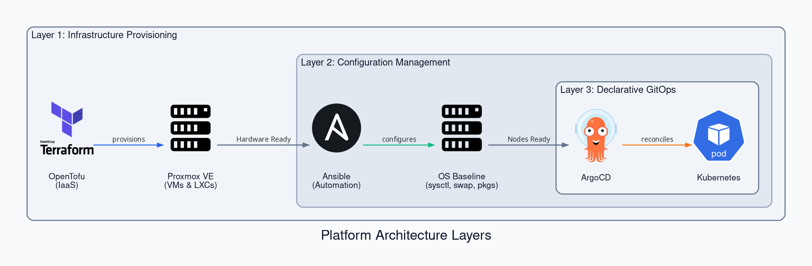
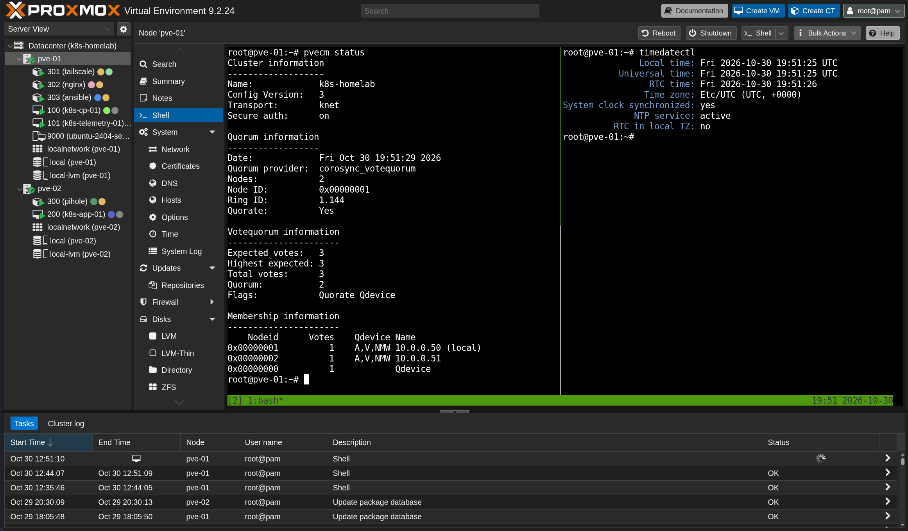
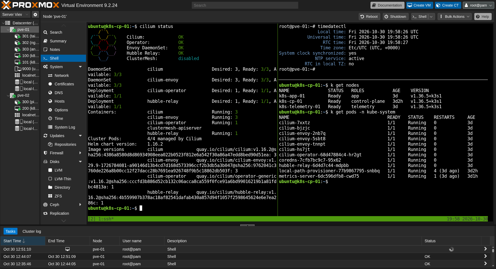

# Platform Provisioning

## Overview

This guide covers the three sequential provisioning layers that build the homelab platform from bare-metal hardware to declarative workload delivery:



- **Layer 1: Infrastructure Provisioning:** Uses OpenTofu and Proxmox VE to configure physical hypervisor clustering, odd 3-vote quorum tiebreaking, authoritative local time synchronization via Chrony, base OS templates, and automated VM and LXC creation.
- **Layer 2: Node OS Baseline Provisioning:** Uses Ansible from the dedicated controller container (`CT 303`) to tune kernel modules, swap, sysctl networking parameters, and core utilities across all virtual machines.
- **Layer 3: Declarative GitOps & Cluster Provisioning:** Uses k3s and ArgoCD to bootstrap the lightweight Kubernetes control plane, deploy the Cilium eBPF network fabric, and initialize the App-of-Apps continuous delivery engine.

---

## Layer 1: Infrastructure Provisioning

### Cluster & Quorum Setup

Physical hosts must be joined into a cluster with an external QDevice tiebreaker to maintain an odd 3-vote quorum:

1. Initialize cluster on the primary node (`pve-01`).
2. Join the secondary node (`pve-02`).
3. Configure the external Raspberry Pi (`rpi-01`) quorum tiebreaker and verify status:

   ```bash
   # On primary node (pve-01):
   pvecm create k8s-homelab

   # On secondary node (pve-02):
   pvecm add <PRIMARY_NODE_IP>

   # On Raspberry Pi (rpi-01):
   sudo apt update && sudo apt install -y corosync-qnetd

   # On Proxmox hosts (pve-01 and pve-02):
   apt update && apt install -y corosync-qdevice

   # On primary node (pve-01), attach the QDevice:
   pvecm qdevice setup <QDEVICE_IP>
   pvecm status
   ```

??? note "Screenshot: Proxmox Cluster & QDevice Quorum"
    

### Time Synchronization

Distributed consensus engines (etcd in k3s and Corosync in Proxmox) require sub-second clock synchronization:

1. Configure the Raspberry Pi (`rpi-01`) as the authoritative local Stratum 2 Chrony NTP server.
2. Configure Proxmox hosts (`pve-01`, `pve-02`) to synchronize against `rpi-01`:

   ```bash
   # On Raspberry Pi (rpi-01): install Chrony and allow local homelab subnets
   sudo timedatectl set-timezone UTC
   sudo apt update && sudo apt install -y chrony
   echo -e "server time.cloudflare.com iburst\nallow 192.168.0.0/16\nallow 10.0.0.0/8" | sudo tee -a /etc/chrony/chrony.conf
   sudo systemctl restart chrony

   # On Proxmox hosts (pve-01 and pve-02): sync against rpi-01
   echo "server <RPI_IP> iburst prefer" | sudo tee -a /etc/chrony/chrony.conf
   sudo systemctl restart chrony && chronyc sources -v
   ```

### Cloud-Init Template

Create the Ubuntu 24.04 Server template (VM 9000) on local hypervisor storage:

1. Download the official Ubuntu 24.04 cloud image.
2. Initialize VM 9000, import the virtual disk to `local-lvm`, and attach the Cloud-Init drive.
3. Convert the virtual machine to a permanent template:

   ```bash
   wget https://cloud-images.ubuntu.com/noble/current/noble-server-cloudimg-amd64.img
   qm create 9000 --name "ubuntu-2404-server-template" --memory 2048 --cores 2 --cpu host --net0 virtio,bridge=vmbr0
   qm disk import 9000 noble-server-cloudimg-amd64.img local-lvm
   qm set 9000 --scsihw virtio-scsi-single --scsi0 local-lvm:vm-9000-disk-0,discard=on,ssd=1
   qm set 9000 --ide2 local-lvm:cloudinit --boot order=scsi0 --serial0 socket --vga serial0
   qm template 9000
   rm -f noble-server-cloudimg-amd64.img
   ```

### OpenTofu Deployment

1. Generate a Proxmox API token (`root@pam!tofu`) with Privilege Separation unchecked under `Datacenter -> Permissions -> API Tokens`.
2. Populate `infra/terraform.tfvars` from `infra/terraform.tfvars.example` with host endpoints, credentials, and static network leases.
3. Deploy virtual machines and containers:

   ```bash
   cd infra
   tofu init
   tofu plan
   tofu apply
   ```

---

## Layer 2: Node OS Baseline Provisioning

Before bootstrapping Kubernetes, all VM nodes must have active swap disabled, kernel networking modules loaded, and sysctl packet forwarding rules applied. This baseline tuning is automated using Ansible from the dedicated controller container (`CT 303` on `pve-01`):

1. Access the controller container (`CT 303`) and verify fleet ping connectivity.
2. Execute the baseline hardening playbook across all target virtual machines:

   ```bash
   # On pve-01: enter controller container and verify connectivity
   pct enter 303
   cd ~/kubernetes-homelab/ansible
   ansible nodes -m ping

   # Execute baseline playbook across k8s-cp-01, k8s-telemetry-01, and k8s-app-01
   ansible-playbook playbooks/setup-vms.yml
   ```

The playbook enforces the following system baselines across all nodes (`k8s-cp-01`, `k8s-telemetry-01`, `k8s-app-01`):

- **Timezone:** Locks system clock to UTC.
- **Swap:** Disables active swap (`swapoff -a`) and permanently comments out swap mounts in `/etc/fstab`.
- **Kernel Modules:** Loads `overlay` and `br_netfilter`, persisting them in `/etc/modules-load.d/k8s.conf`.
- **Sysctl Parameters:** Enables IP packet forwarding (`net.ipv4.ip_forward = 1`) and bridge netfilter calls.
- **Core Packages:** Installs essential troubleshooting utilities (`curl`, `git`, `jq`, `tcpdump`, `socat`, `htop`, `tar`).

---

## Layer 3: Declarative GitOps & Cluster Provisioning

Once the physical hypervisors are clustered (Layer 1) and all virtual machine OS baselines are hardened (Layer 2), the final tier provisions the Kubernetes platform using k3s and ArgoCD as its declarative GitOps delivery engine.

### Preflight Environment Verification

Before running installation scripts, execute `bootstrap/00-preflight.sh` to audit system resources, kernel version, network ports, and verify that the Ansible OS baseline (timezone, swap, kernel modules, sysctl) is active across target nodes:

```bash
./bootstrap/00-preflight.sh
```

### Control Plane Initialization

Bootstrap the isolated control plane on `k8s-cp-01`:

1. Execute the server bootstrap script to write declarative k3s settings with Traefik and Flannel disabled.
2. Verify local control plane status:

   ```bash
   ./bootstrap/01-k3s-server.sh
   kubectl get nodes
   ```

Upon completion, the script outputs the cluster join endpoint and node token directly to the terminal for worker onboarding.

### Worker Node Onboarding

Join worker nodes into the cluster:

1. Execute the agent bootstrap script on `k8s-telemetry-01` and `k8s-app-01`.
2. Apply formal role labels from the control plane (`k8s-cp-01`):

   ```bash
   # On k8s-telemetry-01:
   sudo ./bootstrap/02-k3s-agent.sh \
     --server-url "https://<CONTROL_PLANE_IP>:6443" \
     --token "<JOIN_TOKEN>" \
     --node-role telemetry

   # On k8s-app-01:
   sudo ./bootstrap/02-k3s-agent.sh \
     --server-url "https://<CONTROL_PLANE_IP>:6443" \
     --token "<JOIN_TOKEN>" \
     --node-role app

   # From control plane (k8s-cp-01), apply formal role labels:
   kubectl label node k8s-telemetry-01 node-role.kubernetes.io/telemetry=true
   kubectl label node k8s-app-01 node-role.kubernetes.io/app=true
   ```

!!! note
    In accordance with the Kubernetes NodeRestriction admission plugin, worker nodes self-assign the `workload=<role>` label. Formal role labels are assigned from the control plane.

### CNI & Network Fabric Deployment

Deploy Cilium eBPF in VXLAN overlay mode from `k8s-cp-01`:

1. Deploy Cilium CNI with kube-proxy replacement and Hubble telemetry enabled.
2. Verify cluster health and eBPF datapath status:

   ```bash
   ./bootstrap/03-cni-cilium.sh
   cilium status --wait
   kubectl get nodes -o wide
   kubectl get pods -A
   ```

Key parameters configured by the script:

| Parameter | Value | Purpose |
| :--- | :--- | :--- |
| **Pod CIDR** | `10.244.0.0/16` | Eliminates subnet collisions with the physical LAN |
| **Host Routing** | `bpf.hostLegacyRouting=true` | Protects host-level SSH and management traffic |
| **Kube-Proxy** | In-kernel eBPF | High-performance socket-based load balancing |
| **Hubble** | Relay & UI enabled | Real-time L3/L4/L7 flow observability |

??? note "Screenshot: Cluster Nodes & Cilium Datapath Status"
    

### ArgoCD App-of-Apps Initialization

*Placeholder for deploying the ArgoCD GitOps engine to reconcile platform manifests from Git.*
